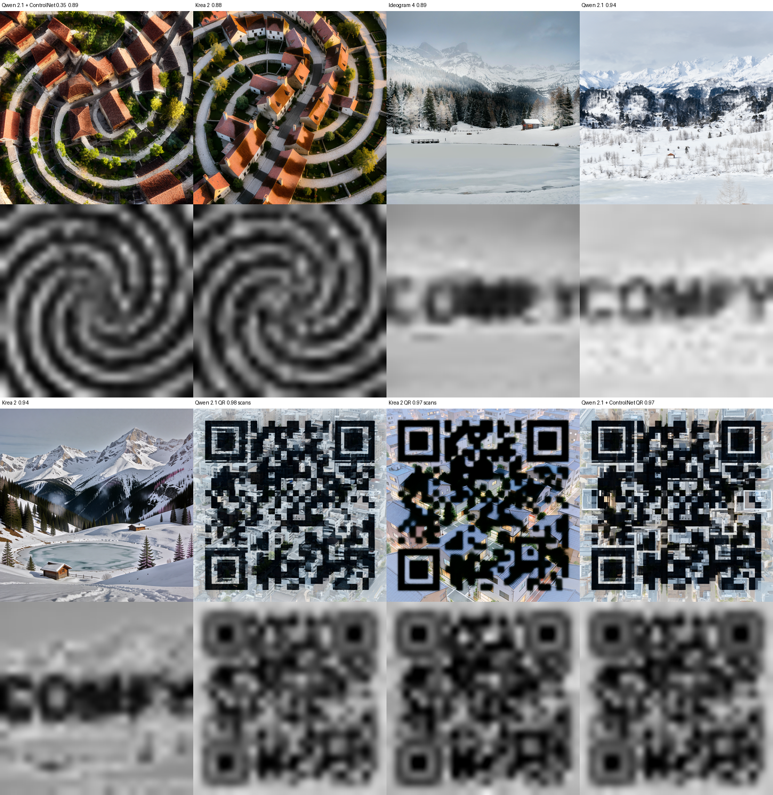

# ComfyUI Illusion Diffusion

Hidden-image optical illusions (spirals, text, logos, scannable QR codes) in the style of the SD 1.5 QR Monster ControlNet, for current models. It needs no training and no extra dependencies, and works without a ControlNet.



**Illusion Guidance** (`model_patches`) patches a `MODEL`. While the composition forms, it pulls the blurred brightness of the predicted image toward your pattern. It changes brightness only, without a colour cast, and leaves fine detail alone. The pull then fades out so the model renders the details on its own. The pattern shows when you squint or step back.

It works with any model whose latent format has preview factors. It was tested on Qwen Image 2.1, Krea 2 and Ideogram 4.

## Install

```bash
cd ComfyUI/custom_nodes
git clone https://github.com/oli-the-hermit/ComfyUI-IllusionDiffusion
```

Restart ComfyUI.

## Use

`Load Diffusion Model` → **Illusion Guidance** → your sampler. Connect a black and white pattern image with the same aspect ratio as the output. Otherwise it is center-cropped. White becomes bright and black becomes dark; use `invert` to swap them.

The example workflows in `example_workflows/` use the patterns in `patterns/`. Copy those into `ComfyUI/input/` first.

| Model | strength | contrast | end_percent | Notes |
|---|---|---|---|---|
| Qwen Image 2.1 | 2.0 | 0.8 | 0.8 | 1.5 with the Grayscale ControlNet below |
| Krea 2 (Turbo) | 2.0–2.5 | 0.8 | 0.8 | |
| Ideogram 4 | 3.0 | 0.8 | 0.75 | Dual Model CFG Guider cfg must stay above 1 |

- **QR codes:** set `blur` to 0.006 and `contrast` to 0.8–1.0. Scans were verified on Qwen Image 2.1 (strength 2.0, contrast 0.8) and Krea 2 (strength 2.0, contrast 1.0). Generate a few seeds and keep the one that scans.
- **Subtler or stronger:** lower or raise `strength`. A higher `blur` hides the pattern deeper.
- **Painted look:** if the pattern looks painted over the scene instead of built from it, lower `strength` or `end_percent`.
- **Ideogram 4 placeholder:** some seeds give Ideogram 4's own "Image blocked by safety filter" picture even without this node. Change the seed.

### Qwen Image 2.1 + Grayscale ControlNet

On Qwen Image 2.1, adding the [Qwen-Image-2.1-Fun-Controlnet-Union](https://huggingface.co/alibaba-pai/Qwen-Image-2.1-Fun-Controlnet-Union) at low weight makes the scene follow the pattern more naturally. Feed it the same pattern image. Use the core `Load Model Patch` and `Apply Fun ControlNet` nodes with strength 0.35 and end_percent 0.5, and lower Illusion Guidance to 1.5. The ControlNet uses the Qwen Research License, which is non-commercial; Illusion Guidance alone does not need it.

## How it works

Each latent format's preview factors map a latent pixel linearly to RGB. At every guided step, the node measures the luminance of the denoised prediction, blurs both it and the pattern, and adds the difference back along the smallest latent direction that raises R, G and B equally. This is the latent-space version of the low-pass projection in *Factorized Diffusion* (Geng et al., 2024).

## License

GPL-3.0, like ComfyUI.
