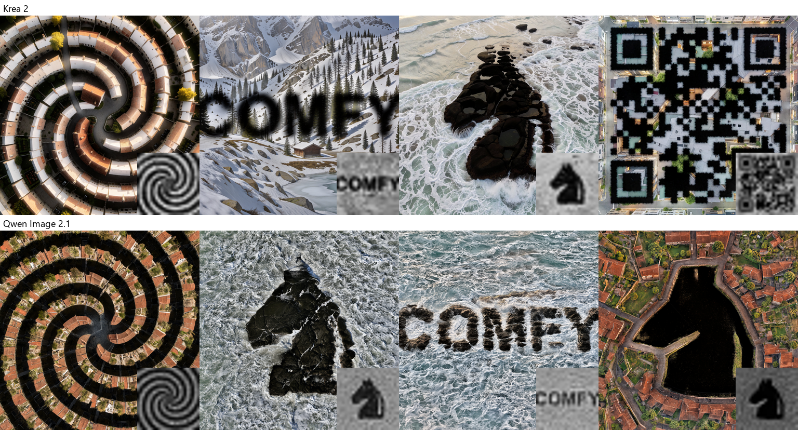

# ComfyUI Illusion Diffusion

Hidden-image optical illusions (spirals, text, logos, QR codes) in the style of the SD 1.5 QR Monster ControlNet, for current models. It needs no training and no extra dependencies, and works without a ControlNet.



**Illusion Guidance** (`model_patches`) patches a `MODEL`. While the composition forms, it pulls the blurred brightness of the predicted image toward your pattern, so the model builds the scene around it: houses line up along a spiral, a forest takes the shape of a silhouette. The pull then fades out and the model renders the details on its own. The pattern shows when you squint or step back.

Version 2 is tuned on Krea 2 and Qwen Image 2.1. It changes the node's inputs, so workflows saved with version 1 need their values set again.

## Install

```bash
cd ComfyUI/custom_nodes
git clone https://github.com/oli-the-hermit/ComfyUI-IllusionDiffusion
```

Restart ComfyUI.

## Use

`Load Diffusion Model` → **Illusion Guidance** → your sampler. Connect a black and white pattern image with the same aspect ratio as the output. Otherwise it is center-cropped. White becomes bright and black becomes dark; use `invert` to swap them.

The example workflows in `example_workflows/` use the patterns in `patterns/`. Copy those into `ComfyUI/input/` first.

| Model | strength | contrast | noise_shaping | Notes |
|---|---|---|---|---|
| Krea 2 (Turbo) | 3.0 | 0.5 | 0 | Noise shaping makes Krea draw a flat graphic |
| Qwen Image 2.1 | 3.0 | 0.35 | 0.5 for organic shapes, 0 for text, checkerboards and QR codes | |

- **Pick a prompt that can carry the pattern.** The model needs things in the scene that are naturally light and dark at the pattern's scale: streets and rooftops, snow and pines, sea foam and rocks. Without them (a close-up forest floor, a crowd from above) the pattern comes out as a shadow or a dark blob.
- **`contrast`** is the brightness difference asked between the pattern's black and white areas. Near 1.0 asks for pure black and white, which no natural scene has, and the result looks painted.
- **`fade_start` and `fade_end`** are noise levels (1 is pure noise, 0 is the finished image). The pull is at full strength down to `fade_start` and gone by `fade_end`. Pulling at lower noise levels than the defaults paints the pattern over the scene.
- **`noise_shaping`** writes the pattern's layout into the starting noise. Qwen Image 2.1 fixes its composition in the first step, and this is what makes it build the pattern from content. With hard-edged geometric patterns it makes Qwen draw a literal graphic or collage.
- **QR codes:** set `blur` to 0.006. On the test set 75% scanned on Krea 2 at the table's settings. Qwen Image 2.1 at these gentle settings scanned 0–8%; raise `contrast` toward 0.8 for QR on Qwen. Generate a few seeds and keep one that scans.
- **Krea 2 Turbo is sensitive:** a tiny change to any setting gives a noticeably different image, much like a new seed.
- **Other models:** any model whose latent format has preview factors runs, but the brightness direction is only calibrated for the Krea 2 and Qwen Image 2.1 latents, and the defaults are untested elsewhere. Ideogram 4 worked with version 1.0.0; with version 2 its pattern comes out weak.

## How it works

Each latent format's preview factors map a latent pixel linearly to RGB. At every guided step, the node measures the luminance of the denoised prediction, blurs both it and the pattern, and adds the difference back along the latent direction that a real brightness change follows. That direction was measured by encoding images and brightened copies through each VAE. The smallest step that raises the preview RGB is a different direction and decodes with a dot-grid texture.

The timing comes from measuring where a push ends up. In the first steps (noise level above about 0.85) it decides the layout, so the scene is built around the pattern; pushed many times harder there, the model draws a flat graphic instead. Between about 0.85 and 0.6 a push becomes light and shadow on a scene that is already laid out. Below that it stays as an overlay. The experiments are in [NOTES.md](NOTES.md).

The low-pass projection is the latent-space version of the one in *Factorized Diffusion* (Geng et al., 2024).

## License

GPL-3.0, like ComfyUI.
